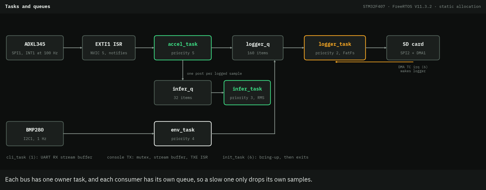
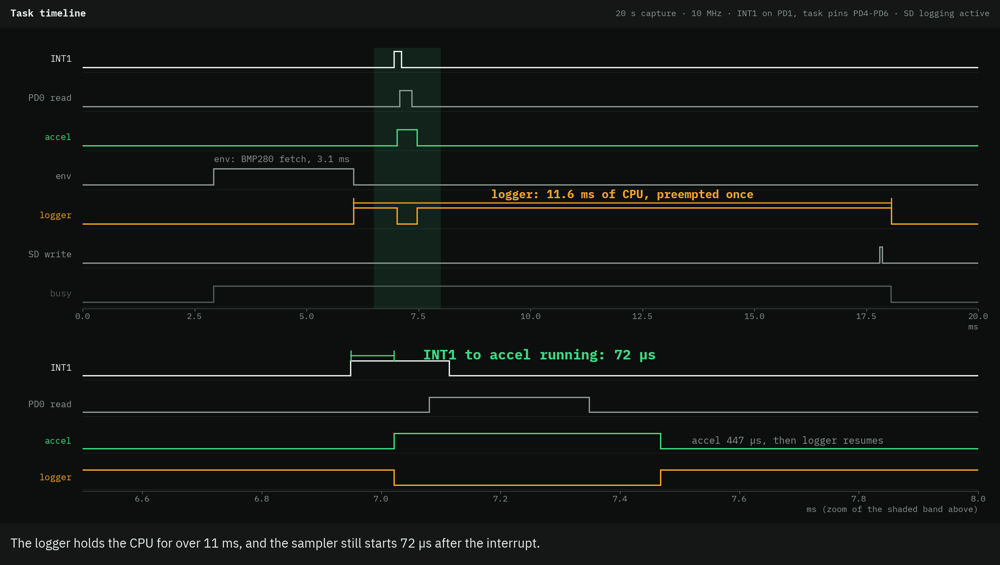
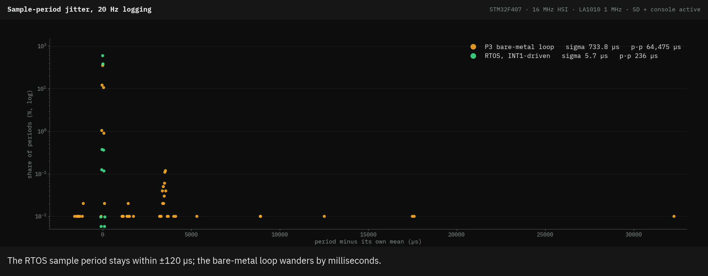
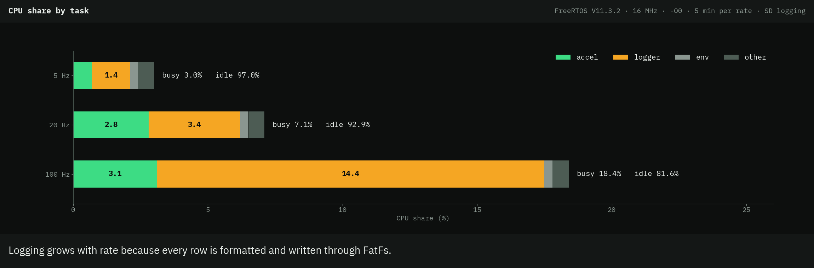
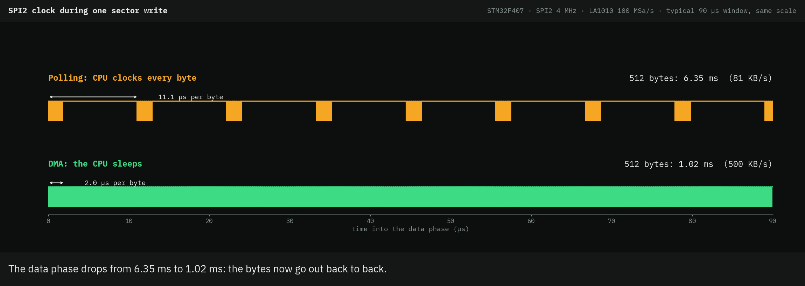
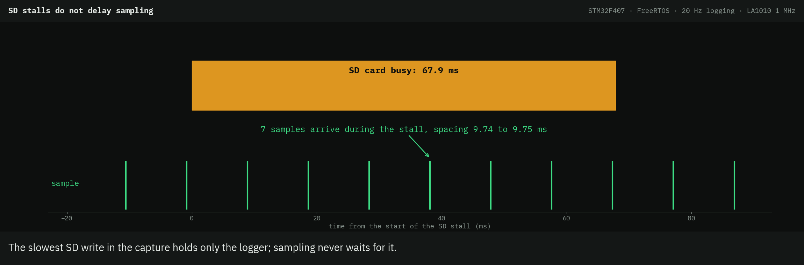

# STM32F4 FreeRTOS Datalogger

FreeRTOS port of [stm32f4-datalogger](https://github.com/edgeaiguy/stm32f4-datalogger) (`v3.0`): the same sensors, SD card and CLI, rebuilt as tasks. Every timing and size figure is measured against the bare-metal version.

**Status:** `v4.0`: all milestones done (m1 to m5), measured on hardware.

## At a glance

| | v3.0 bare metal | This project |
|---|---|---|
| Sample-period jitter at 20 Hz (σ) | 734 µs | 5.7 µs |
| Peak-to-peak period error | 64.5 ms | 236 µs |
| INT1 edge to accel task running | n/a (polled) | 73 µs mean, 161 µs max |
| SD data phase, 512 bytes | 6.35 ms, CPU busy | 1.02 ms, CPU asleep (DMA) |
| Logger CPU at 100 Hz | n/a | 9.7%; whole system 84.5% idle with the second consumer |
| 10 h soak at 100 Hz | n/a | 3,707,373 rows, 0 drops, 0 gaps |
| Flash / bss (`arm-none-eabi-size`) | 37,200 B / 4,144 B | 70,772 B (text 69,380 + data 1,392) / 16,928 B |

Everything is measured on the board with a logic analyzer, the run-time stats and the DWT cycle counter; the sections below show how. Raw captures and the scripts that process them are in `tools/` and `docs/PLAN.md`.

Plan, milestones and current status: [docs/PLAN.md](docs/PLAN.md).

## m1: kernel

FreeRTOS-Kernel V11.3.2 is vendored under `Lib/FreeRTOS-Kernel/`, unmodified, and runs on the STM32F407 at a 1 kHz tick from HSI 16 MHz. Everything is statically allocated (`configSUPPORT_DYNAMIC_ALLOCATION 0`), so all kernel RAM shows up in `.bss`.

On the board: two LED tasks (green PD12 at 1 Hz, orange PD13 at 5 Hz) and a live CLI on USART2 (PA2 TX, PA3 RX, 115200 8N1). This is our proof-of-life.

- **Console TX:** tasks write into a 256-byte stream buffer under a mutex; the USART2 TXE interrupt drains it. A full buffer drops bytes and counts them, so printing never blocks a task on the UART.
- **CLI RX:** the USART2 RX interrupt pushes each byte into a stream buffer with `xStreamBufferSendFromISR`; `cli_task` blocks on it. USART2 sits at NVIC priority 7, below the syscall ceiling of 5, which `FromISR` calls require.

### Size cost vs v3.0

Same flags (`-O0`, hard-float). Flash is text + data.

| | Flash | bss |
|---|---|---|
| `v3.0` | 37200 | 4144 |
| m1 | 57236 | 7728 |
| Delta | +20036 | +3584 |

The kernel objects alone are 22169 B of flash and 880 B of bss. The comparison is not yet clean: unused P3 drivers are still linked.

## m2: sensor tasks

Bring-up now runs inside a priority 5 `init_task`, because `sdcard_init` and `rtc_init` time out on the kernel tick, which does not advance before the scheduler starts. It starts the other tasks and deletes itself. We give `init_task` the highest priority so no other task can preempt it on bring-up.

| Task | Priority | Wakes on | Owns |
|---|---|---|---|
| `init_task` | 5 | start | bring-up |
| `accel_task` | 4 | ADXL345 INT1 | SPI1 |
| `env_task` | 3 | 1 Hz `xTaskDelayUntil` | I2C1 |
| `cli_task` | 1 | RX stream buffer | |

- **Accelerometer:** INT1 (DATA_READY, ODR 100 Hz) drives EXTI1 on PD1. The ISR calls `vTaskNotifyGiveFromISR`; `accel_task` reads XYZ over SPI1, which also clears INT1. A 1 s take timeout recovers from a missed edge.
- **Barometer:** the BMP280 read is split into `bmp280_trigger()` and `bmp280_fetch()`. `env_task` sleeps through the ~43 ms conversion instead of polling the bus.
- **Probes:** PD0 rises at the accel read start; PD2 is high while any non-idle task runs (`traceTASK_SWITCHED_IN`). `PROBE_ENABLED 0` compiles both out.

### Sample cadence

Logic-analyzer capture, 500 s, PD0 rising edges (`tools/jitter.py`):

| Periods | Mean | σ | p99 \|dev\| | Peak-to-peak | Busy |
|---|---|---|---|---|---|
| 51365 | 9734.0 µs | 4.1 µs | 11 µs | 215 µs | 7.6% |

The mean is 2.7% fast of the 100 Hz requested: that is the ADXL345's own clock, not the scheduler. Periods in the 50 ms after each barometer trigger have σ 9.2 µs against 3.8 µs elsewhere, with the same mean. There is no SD card or logger yet, so this is not directly comparable with the v3.0 figures; the like-for-like comparison comes in m3 and m4.

## m3: logger

A priority 2 `logger_task` now writes the same CSV the bare-metal version did. `accel_task` and `env_task` post readings into a 32-item queue (160 since m4, see the soak) with a zero timeout; each message carries a per-type sequence number, so a gap on arrival shows exactly what was dropped. The logger converts the raw DWT cycle count to milliseconds, attaches each env reading to the next accel row (empty columns otherwise), and syncs the file every 5 s. FatFs is used by one task at a time: `init_task` opens the file during bring-up, then the logger owns it.

| Task | Priority | Wakes on | Owns |
|---|---|---|---|
| `init_task` | 5 | start | bring-up, opens the log file |
| `accel_task` | 4 | ADXL345 INT1 | SPI1 |
| `env_task` | 3 | 1 Hz `xTaskDelayUntil` | I2C1 |
| `logger_task` | 2 | `logger_q` | SPI2 + FatFs |
| `cli_task` | 1 | RX stream buffer | |

Console commands: `rate <hz>` (1, 2, 4, 5, 10, 20, 25, 50, 100), `start`, `stop`, `status`, `time YYYY-MM-DD HH:MM:SS`. `rate` reaches `accel_task` through a task notification; the sensor runs the lowest output rate the requested rate divides exactly and the task forwards every Nth sample. `tools/settime.py` sets the board clock from the host over the console UART.

### 20 Hz against v3.0

500 s logic-analyzer capture with the SD card writing, logged-sample periods:

| | RTOS m3 | v3.0 |
|---|---|---|
| σ | 6.5-7.9 µs | 734 µs |
| p99 \|dev\| | 17-36 µs | 3.4 ms |
| Peak-to-peak | 159-236 µs | 64.5 ms |
| CPU busy | 8.6% | 21.3% |

The jitter figure in the m4 section is drawn from one saved capture (`rtos-m3-20hz.csv`, σ 5.7 µs, 236 µs peak-to-peak); the range above covers the m3 runs, which differ by a few µs.

The SD card still stalls the logger: a sector write takes 5-15 ms, a sync about 43 ms and the worst seen was 68 ms. In v3.0 those stalls delayed the next sample; here they delay only the logger, whose queue peaked at 2 of its 32 slots (160 now). The sample rate is set by the ADXL345's own clock, which runs about 2.6% fast, so "20 Hz" logs at 20.52 Hz. The wall-clock column comes from the RTC's internal oscillator and runs several percent fast (m4 calibrates it to within 0.6-0.7%); `t_ms` is the reliable time base.

## m4: measured

Everything below was measured on the board with a Kingst LA1010 on probe GPIOs, the run-time stats (TIM2 at 100 kHz) and a 10 h soak. Same hardware and probe pins as the v3.0 baseline.

### Task timeline

Three GPIOs follow the running task. INT1 to the accel task running takes a median of 72 µs (mean 73.5 µs, σ 4.4 µs, max 161 µs). The accel task's slice is 277 µs, of which the 184 µs SPI read is most. The `env` task's 3.1 ms slice is the blocking BMP280 fetch; the logger's longest slice is 14.7 ms (SD sync). The accel task preempts both.

> This is a significant finding! We have proven the use case for FreeRTOS preemption - our higher priority `accel_task` preempted the already running lower priority `logger_task`, performed its work, then gave back the CPU to `logger_task` once it finished. This will come in handy when we add `infer_task` in Project 5.

### Jitter against v3.0

Period minus its own mean, same axes. v3.0 has σ 734 µs and tails out to 32 ms; the RTOS has σ 5.7 µs and 236 µs peak-to-peak. The RTOS samples are paced by the sensor's 100 Hz clock and decimated to 20 Hz; v3.0 ran a 20 Hz timer, so the periods differ (9.7 against 50 ms) while the deviations are comparable.

### CPU cost by rate

| Logged rate | Idle | Queue peak | Drops | Worst SD write / sync |
|---|---|---|---|---|
| 5 Hz | 97.0% | 2 | 0 | 35.8 / 42.4 ms |
| 20 Hz | 92.9% | 2 | 0 | 16.5 / 43.8 ms |
| 100 Hz | 81.6% | 5 | 0 | 44.3 / 44.0 ms |

The tick costs 6.3 µs on average (0.62% of the CPU at 1 kHz). Stacks are trimmed to the measured high-water mark plus 30%. The RTC wall clock is calibrated against the LSI at cold start and runs 0.6-0.7% fast, down from several percent.

### 10 h soak at 100 Hz

3,707,373 rows, 0 write errors, 0 dropped samples, 0 gaps, one barometer reading per second for the full run, and `tools/check_log.py` passes. The logger queue peaked at 95 of 160 slots (worst SD sync 653 ms); a 32-slot queue would have overflowed.

The soak found three real defects that 5-minute runs never showed: a hung I2C bus, SD stalls deeper than the queue, and a BMP280 that stopped answering about once an hour. The last one was a read-modify-write of the I2C control register racing the hardware's STOP, plus a task switch inside the read's one-byte timing window. See the below section "What went wrong": I'll have more on this in a "lessons learned" follow-up article.

Limits: the `stats` CPU percentages wrap after about 11.9 h and `t_ms` after 49 days.

## m5: DMA

SPI2 TX and RX run on DMA1 (stream 4 sends, stream 3 receives, channel 0). The 512-byte data phase of every SD block read and write is handed to the DMA controller; the logger task sleeps in `ulTaskNotifyTake` until the receive stream's transfer-complete interrupt (NVIC priority 6, below the kernel's ceiling) notifies it, with a 100 ms timeout that stops both streams and fails the transfer. SPI is full duplex, so both streams always run: a write receives into a one-byte sink and a read sends 0xFF from a constant. Commands, the data token, the CRC and the busy poll stay polled.

| 512-byte data phase | Polling | DMA |
|---|---|---|
| Duration | 6.35 ms | 1.02 ms |
| Byte spacing | median 11.14 µs | 2.00 µs |
| Throughput | 81 KB/s | 499 KB/s |

The clock is 4 MHz, so 2.00 µs per byte is the wire's limit: the bytes now go out back to back and the CPU is asleep for the transfer. The whole chip-select window of a sector write fell from 7.67 ms to 3.21 ms; the rest is the card programming its flash, which only the card controls.

| Logged rate | Logger CPU (m4 -> m5) | Idle (m4 -> m5) |
|---|---|---|
| 5 Hz | 1.4% -> 0.9% | 97.0% -> 97.8% |
| 20 Hz | 3.4% -> 2.2% | 92.9% -> 94.3% |
| 100 Hz | 14.4% -> 9.7% | 81.6% -> 86.5% |

The 4.7 points recovered at 100 Hz equal the 5.3 ms saved per sector times the 9.4 sectors written each second. All runs: 0 drops, 0 gaps, `check_log.py` passes.

## v4.0: a second consumer

`accel_task` posts every logged sample to a second queue, `infer_q`, read by `infer_task` (priority 3, between env and logger). The stub takes 64-sample windows and keeps the RMS per axis; a real model slots in here later. Each consumer has its own queue and drop counter, so a stalled one only loses its own samples.

| Logged rate | infer CPU | Idle | Drops / gaps |
|---|---|---|---|
| 5 Hz | 0.1% | 97.3% | 0 / 0 |
| 20 Hz | 0.3% | 93.9% | 0 / 0 |
| 100 Hz | 1.6% | 84.5% | 0 / 0 |

The cost is 1,416 B of flash and 1,520 B of RAM (stack, queue, task block); the CPU cost is mostly the context switch to wake the task once per sample.

The isolation test: with the consumer switched off for 30 s at 100 Hz, `infer_q` dropped 3,053 samples while `logger_q` and `accel_task` had 0 drops and 0 gaps and logging kept writing. When it came back on, its gap count equalled its drop count, so every missing sample is accounted for by the sequence numbers.

## Design decisions

- **One owner task per bus, no mutexes.** I2C1 belongs to `env_task`, SPI1 to `accel_task`, SPI2 and FatFs to `logger_task`. The only genuinely shared resource is the UART transmit path, which goes through a mutex into a stream buffer.
- **The sensor's clock sets the sample time.** The ADXL345's INT1 edge wakes `accel_task` through a task notification, so the sample period is the sensor's, not a software timer's.
- **A queue per consumer, sent with zero timeout.** Producers never block. A full queue drops the sample and counts it; the per-type sequence number shows the gap on the other side.
- **Static allocation only.** No heap, so all kernel memory is visible in `.bss`.
- **Everything else stays like v3.0.** 16 MHz HSI, `-O0`, same CSV schema, so each difference from the bare-metal version is attributable to the RTOS and not to a faster clock.
- **DMA only for the 512-byte data phase.** Commands, the data token, the CRC and the busy poll stay polled: they are a few bytes, and the busy time belongs to the card.
- **Stacks sized from measurement**: the high-water mark plus 30%.

## What went wrong

Five-minute runs passed. The 10 h soak found three defects:

- **A hung I2C bus.** A slave left holding SDA low stopped the BMP280 for good. Fix: clock SCL up to nine times, send STOP, reset the peripheral, at start-up and on a bus-busy timeout.
- **SD stalls deeper than the queue.** Over hours the card stalled for 312 ms on a write and 662 ms on a sync; a 32-item queue overflows at 100 Hz. The sizing rule is rate times stall times two, so the queue is 160 items (peak 95 in the soak).
- **A BMP280 that stopped answering about hourly.** Instrumenting every I2C error exit showed the STOP never completing. Two causes: a task switch inside the one-byte-time window where a short read must be told to stop, and clearing a mode bit in the same register right after requesting STOP, a read-modify-write that could put the STOP bit back after the hardware had cleared it. Now the window is a critical section and the bit is cleared only after STOP completes. The env task also resets the sensor after three failed reads as a safety net.

One calibration problem too: the RTC's internal oscillator ran several percent fast. It is now measured against the HSI with a timer capture at cold start, which brings it to within 0.6 to 0.7%, limited by the HSI itself.

## Limits

`stats` CPU percentages wrap after about 11.9 h (a 32-bit counter at 100 kHz), `t_ms` after about 49 days, and the accelerometer is read at its 100 Hz output rate without the FIFO, so vibration-rate sampling needs the FIFO and a higher rate. Clock speed and optimization are deliberately left at 16 MHz and `-O0`.

